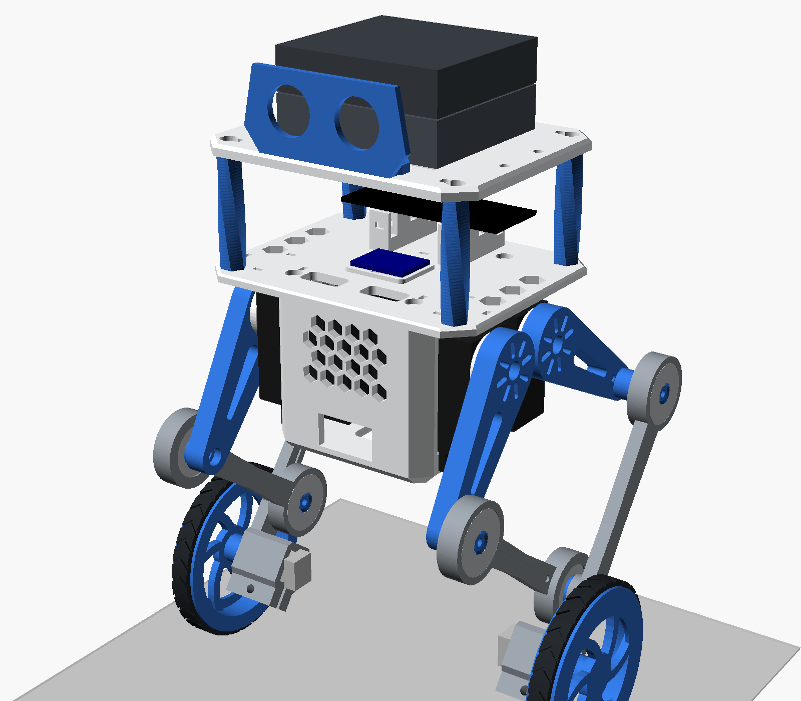
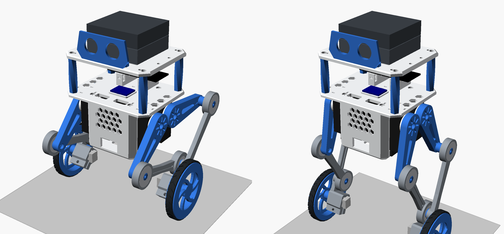
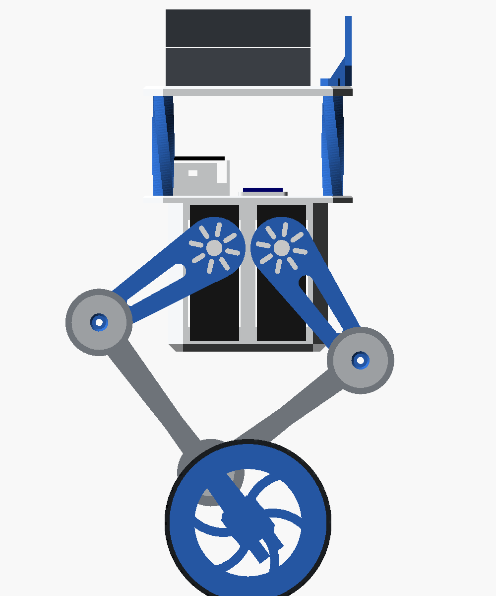
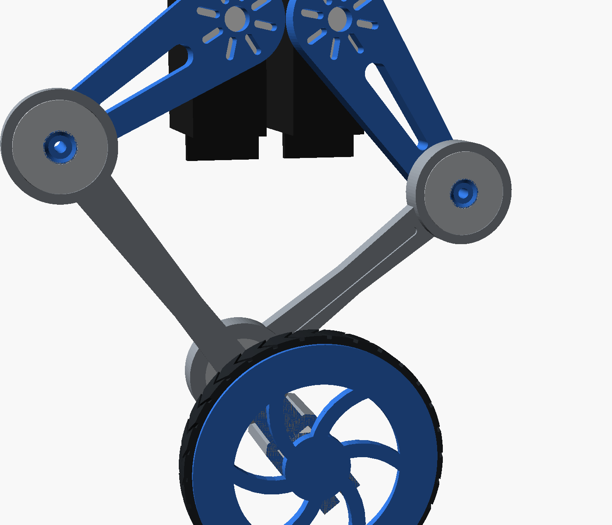
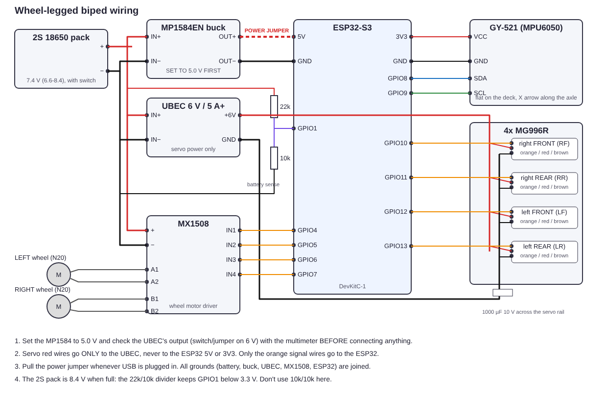
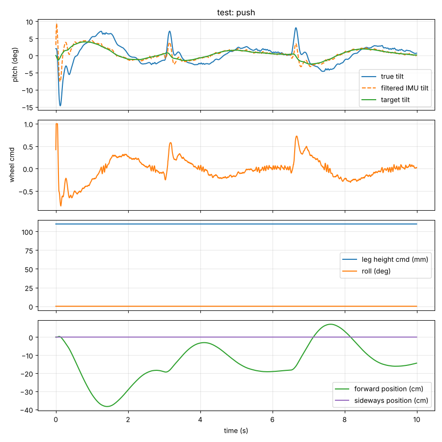
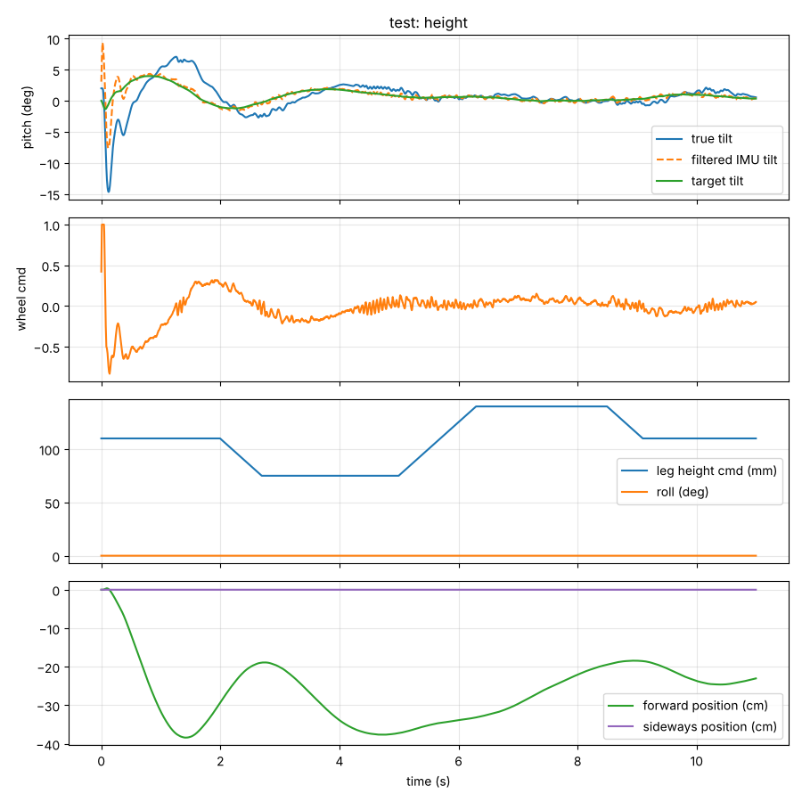
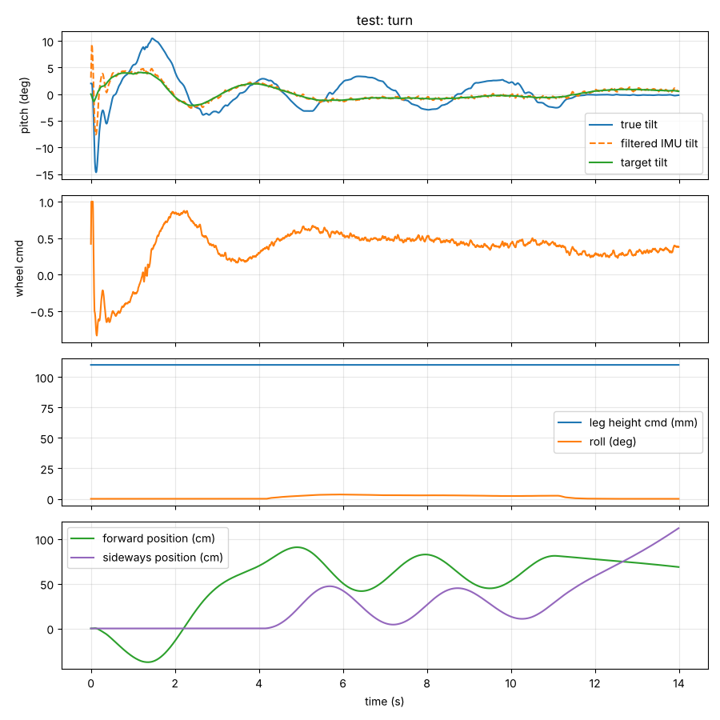

# Wheel-Legged Biped

**A small, 3D-printed, Ascento-style robot that balances on two wheels and uses its legs to crouch, stand tall and lean into turns.**

ESP32-S3 · MPU6050 · 4x MG996R · 2x N20 · PLA + TPU · MuJoCo sim · phone control over Wi-Fi

<p align="center"></p>

| | |
|---|---|
| **Height** | 19 cm crouched · **23 cm standing** · 26 cm fully stretched |
| **Width** | 16 cm across the tyres |
| **Mass** | ~680 g on 2S 18650 (~790 g on two 4xAA packs) |
| **Legs** | Five-bar linkage per leg, both MG996R servos inside the body, 608 ball bearings in the knee joints |
| **Wheels** | N20 6 V 300 rpm gear motors, TPU tyre on a PLA hub |
| **Brain** | ESP32-S3 DevKitC-1 + MPU6050, tuning page and joystick on your phone |
| **Status** | Designed, simulated, firmware compiles. Test prints fit. Not yet balanced on hardware |

<p align="center"></p>

---

## Contents

- [How the legs work](#how-the-legs-work)
- [Repository layout](#repository-layout)
- [1. Parts](#1-parts)
- [2. Power options](#2-power-options)
- [3. Printing](#3-printing)
- [4. Assembly](#4-assembly)
- [5. Wiring](#5-wiring)
- [6. Firmware, one stage at a time](#6-firmware-one-stage-at-a-time)
- [7. Simulation](#7-simulation-mujoco)
- [8. Notes and limits](#8-notes-and-limits)

---

## How the legs work

Each leg is a **five-bar linkage** (side view below, front is to the right). Both servos sit in the body and each turns a short crank. Link A and link B meet at a knee joint, and link B carries on down to the wheel motor. Turning both cranks together raises or lowers the wheel; turning them against each other moves it forward or back. No servo rides on the leg, so the legs stay light, which makes balancing easier.

<p align="center"></p>

The geometry (servo shafts 27 mm apart, crank 55 mm, link A 75 mm, link B 100 mm) comes from `sim/leg_kinematics.py`. Holding the robot up takes at most **0.19 N·m per servo** at any height, about a fifth of what an MG996R can deliver (the table assumes 4 N per wheel, i.e. a robot of up to ~800 g).

| Wheel depth below the shafts | Robot height | Front crank | Rear crank | Servo torque (static) |
|---|---|---|---|---|
| 72 mm (lowest) | 19 cm | 50° | -91° | 0.18 N·m |
| 110 mm (default) | 23 cm | 35° | -57° | 0.17 N·m |
| 145 mm (highest) | 26 cm | 11° | -22° | 0.08 N·m |

Crank angles are measured from straight down, + = toward the front.

**Development is staged.** In stages 4 and 5 the servos are simply held at the 110 mm pose, so the legs act as rigid struts and the robot behaves like a plain two-wheeled balancer. Stage 6 then moves the legs while it balances. One new thing at a time.

## Repository layout

| Path | What it is |
|---|---|
| `stl/` | Ready-to-print parts, already oriented |
| `cad/wheel_biped.scad` | Parametric OpenSCAD source. `part="assembly"` with `wheel_depth=70..145` shows the robot at any height |
| `firmware/` | PlatformIO project, one environment per stage (6 stages) |
| `sim/` | MuJoCo model with closed-loop legs, the same controller as the firmware, leg kinematics |
| `docs/` | Renders, wiring diagram (`wiring.png`, `wiring.svg`, generator in `docs/src/`), sim plots |

---

## 1. Parts

**Electronics and motion**
- ESP32-S3 DevKitC-1 (N16R8)
- MPU6050 breakout (GY-521)
- 4x MG996R servos (generic 180° metal-gear ones are fine)
- 2x N20 6 V 300 rpm gear motors (12 x 10 mm body, 3 mm D-shaft)
- 1x MX1508 dual motor driver
- MP1584EN buck converter (5 V for the ESP32)
- Resistors 22k + 10k (battery sensing), 1000 µF 10 V+ capacitor
- Optional: HC-SR04, which fits the visor

**Hardware**
- 6x 608 ball bearings (8 x 22 x 7 mm, skateboard bearings), 3 per leg
- M3 bolts: 4x M3x12 + 2x M3x20 for the leg joints (no nuts: they thread into the printed bushings), 2x M3x16 + nuts for the motor clamps, plus ~12x M3x8 for the frame
- ~12 M3 heat-set inserts (or set `use_inserts = false` and screw into the plastic)
- 2 small M2 screws (wheel hub onto the shaft flat), zip ties, a 20 mm velcro strap

**Filament:** PLA in white, blue and grey, plus TPU 95A for the tyres.

## 2. Power options

| Option | What you need | Good for |
|---|---|---|
| **A. Two 4xAA packs** (nothing to buy) | Pack 1 → servos only. Pack 2 → MX1508 + MP1584 → ESP32. **Minus wires of both packs joined**, plus sides separate | Stages 1 to 5. Alkalines last roughly 20 to 40 min of balancing and get weaker as they drain |
| **B. 2S 18650 + UBEC** (recommended upgrade, ~€35 to 50) | 2x high-drain 18650 (Molicel P28A, Samsung 25R, Sony VTC5A) in a 2S holder, a 6 V ≥5 A UBEC for the servos, an 18650 charger | Everything, including stage 6 with the legs moving |

Notes:
- The MG996Rs take 4.8 to 7.2 V, so a 4xAA pack can drive them directly. Never connect them to 2S (8.4 V) without the UBEC.
- The MP1584 is too weak (~2 A) to drive four servos. Only use it for the ESP32.
- The N20s are 6 V motors. On 2S the firmware scales the PWM so they never get more than 6.5 V on average, using the battery voltage it reads on GPIO1.
- On AA packs, set `BATTERY_LOW_V` to 4.5 in `config.h`.

## 3. Printing

PLA, 0.20 mm layers, no supports. In Bambu Studio, import all the STLs, use right-click → *Set number of instances*, and press **A** to arrange. Set walls and infill per part under **Strength**.

| Plate | File | Qty | Colour | Walls | Infill |
|---|---|---|---|---|---|
| **1 · Body** | `chassis.stl` | 1 | ⬜ White | 3 | 25% grid |
| | `deck.stl` | 1 | ⬜ White | 3 | 25% grid |
| | `top.stl` | 1 | ⬜ White | 3 | 25% grid |
| **2 · Accents** | `crank.stl` | 4 | 🟦 Blue | **5** | **50% gyroid** |
| | `pillar.stl` | 4 | 🟦 Blue | 4 | 25%, standing up, 5 mm brim |
| | `wheel_hub.stl` | 2 | 🟦 Blue | 4 | 30% gyroid |
| | `visor.stl` | 1 | 🟦 Blue | 3 | 25%, face down |
| **3 · Links** | `link_a.stl` | 2 | ⬛ Grey | **5** | **50% gyroid** |
| | `link_b.stl` | 2 | ⬛ Grey | **5** | **50% gyroid**, flat side down |
| | `bushing.stl` | 4 | 🟦 Blue | 4 | 100%, collar down (print with plate 2) |
| | `bushing_long.stl` | 2 | 🟦 Blue | 4 | 100%, collar down (print with plate 2) |
| **4 · Tyres** | `tire.stl` | 2 | TPU 95A | 3 | 20%, external spool (not the AMS), Generic TPU profile |

- One colour per plate, so no colour changes mid-print.
- Left and right legs use identical parts; the left ones are just flipped over.
- **Print a test set first** (1 crank, 1 link_a, 1 link_b, 1 bushing, 1 wheel_hub) to check the horn, bearing, motor and shaft fits.
- Bearing fits: the 608 should press into the link by hand or with a vice (`bear_fit`, now 0.15; tighter 0.05, looser 0.25), and the bushing should press into the bearing (`bush_d`, now 7.95; looser 7.85, tighter 8.05).
- The cranks fit the round disc horn that comes with generic MG996Rs (~21 mm, 25T spline). Eight radial slots line up with any hole circle. If your horn is a different size, change `horn_d`.
- The N20 pocket goes right through link B and a pinch bolt clamps it. Fit tweaks: `servo_clear` / `servo_clear_end` (servo openings in the chassis, now 0.7 mm per side and 1.1 mm per end, cut through the full servo depth, no cable notch), `motor_tol` (N20 pocket, now 0.2) and `shaft_fit` (wheel hub D-hole, now 0.25).

Re-exporting a part after changing a parameter:
```
openscad -D 'part="crank"' -o stl/crank.stl cad/wheel_biped.scad
```

## 4. Assembly

Front = the side with the front servos. Left and right are as seen from behind.

1. **Inserts.** Iron at ~220 °C: the 4 posts at the top corners of the chassis and both ends of all 4 pillars.
2. **Centre the servos.** Wire the servo signals and power (section 5), flash **stage3_legs**, type `pose90`. Do this *before* fitting any horns.
3. **Servos into the chassis.** Push each one in from the outside, **shaft end up**, wire down through the floor hole. Fix it with the screws from the servo bag.
4. **Cranks.** Screw each crank to a disc horn (2 to 4 small screws through the horn's holes into the crank's slots). With the servos still at 90°, push the horns on so the **front cranks point ~30° forward of straight down** and the **rear cranks ~55° backward**. The spline only allows 14° steps; pick the closest and the trim fixes the rest. Add the horn's centre screw through the hole in the crank.
5. **Bearings and links.** Each leg has three 608 bearings, one in every passive joint.
   - Press the bearings in: one at each end of link A and one at the top of link B. Each seat has a thin lip on one side; push the bearing in from the open side until it sits on the lip.
   - Each joint is: M3 bolt (head sunk into the counterbore) → the part without the bearing → bushing collar → bushing spigot pressed into the bearing. The bolt cuts its own thread in the bushing, so no nut and no washers are needed. Tighten until the bushing is locked to that part (the bearing does all the turning), and stop before the plastic strips.
   - Front crank + link A: `bushing` + M3x12, head on the servo side of the crank.
   - Rear crank + link B: `bushing_long` (it spans link A's layer) + M3x20, head on the servo side of the crank.
   - Link A + link B (the hole 75 mm down link B): `bushing` + M3x12, head on the outside of link B (the counterbore keeps it clear of the wheel).

   Link B goes on the outside, with its motor block pointing in toward the body.

<p align="center"></p>
6. **Motors.** Push each N20 into link B's block from the inside until the gearbox face is flush with the outer side of the link. Tighten the pinch bolt (M3x16 + nut).
7. **Wheels.** Hub onto the shaft with an M2 screw onto the flat, then stretch the TPU tyre over the hub.
8. **Deck.** ESP32 on the posts (pins down). MPU6050 flat on the centre pad, **X arrow pointing left-right**. MX1508 front left, servo supply front right, MP1584 under the ESP32. Bolt the deck to the chassis.
9. **Top.** Pillars, top plate, battery pack(s) on top with velcro, visor on the two front grid holes.

## 5. Wiring

<p align="center"></p>

The diagram shows option B (2S + UBEC). For option A, replace the UBEC with AA pack 1 and the 2S pack with AA pack 2, and join both minus wires.

| From | To |
|---|---|
| Battery + (after the switch) | MX1508 `+`, MP1584 `IN+`, servo supply `IN+`, 22k resistor |
| Battery − | MX1508 `−`, MP1584 `IN−`, servo supply `IN−`, common ground |
| MP1584 `OUT+` (set to 5.0 V) | **power jumper** → ESP32 `5V` |
| MP1584 `OUT−` | ESP32 `GND` |
| Servo supply `+` / `−` | All 4 servo red / brown wires, 1000 µF across them |
| Servo signals (orange) | RF → `GPIO10`, RR → `GPIO11`, LF → `GPIO12`, LR → `GPIO13` |
| GY-521 VCC / GND / SDA / SCL | `3V3` / `GND` / `GPIO8` / `GPIO9` |
| MX1508 IN1 to IN4 | `GPIO4` to `GPIO7` (motor A = left wheel, motor B = right wheel) |
| Battery sense | Battery + → 22k → `GPIO1` → 10k → GND |

> **Three rules**
> 1. Set the MP1584 to **5.0 V** (and the UBEC to 6 V) with a multimeter before connecting anything.
> 2. Servo red wires go **only** to the servo supply. Only the orange signal wires go to the ESP32.
> 3. **Pull the power jumper whenever USB is plugged in.** All grounds are joined.

## 6. Firmware, one stage at a time

Open `firmware/` in VS Code with PlatformIO and pick the environment in the status bar (`env:...`). It's pinned to Arduino core 3.3.9 (pioarduino 55.03.39). Every pin and number lives in `firmware/include/config.h`.

| Stage | Power | What you do | Done when |
|---|---|---|---|
| `stage1_imu` | USB only | Watch the Serial Plotter. Lean forward, tip onto the right wheel, turn left | Pitch **+** leaning forward, roll **+** tipping right, yaw **+** turning left. Otherwise flip `PITCH_SIGN` / `ROLL_SIGN` / `YAW_SIGN` |
| `stage2_motors` | USB + battery, **jumper out**, robot on its back | Type `f`, `b`, `l`, `r`, `d` | `f` rolls toward the front. Fix with `LEFT_INVERT` / `RIGHT_INVERT`; put the `d` result in `MOTOR_DEADBAND` |
| `stage3_legs` | USB + battery, jumper out, robot held up | `pose90` (before the horns), `h 110`, `sweep`, `trim rf 3`, `save` | At `h 110` both wheels sit under the middle of the chassis at equal height. Wrong direction on `h 120`: flip `SERVO_DIR_..` |
| `stage4_balance` | Battery, jumper in, no USB | Switch on lying down, wait 2 s, join Wi-Fi **WheelBiped** (`biped1234`), open **http://192.168.4.1**, stand it up | Balances with the legs fixed. Tune, then **Save** |
| `stage5_drive` | Same | Joystick on the page | Drives and turns |
| `stage6_legs` | Same | Height, Lean and Levelling sliders | Crouches and stands while balancing, leans into turns |

**Controller.** A complementary filter estimates the tilt, PID on the tilt drives the wheels, and a slower speed loop picks the target tilt. On top of that:
- **Height** moves toward the slider at most 50 mm/s. The balance loop treats it as a small disturbance.
- **Leaning into turns.** Sideways acceleration = speed × turning rate (from the gyro). The body is tilted by `Lean × atan(accel / g)`: the outer leg gets longer and the inner one shorter.
- **Levelling.** If the robot rolls sideways, the low side's leg gets longer. Off by default; try 0.5 to 1.5.

**Tuning tips** (start from the defaults, which come from the sim, and change one thing at a time):
- Fast buzzing: lower Kd, then Kp. Slow rocking that grows: raise Kd a little.
- Topples slowly before catching itself: raise Ki. With brake-mode PWM the motors act like speed controls, so Ki does most of the work.
- Rolls away in one direction: adjust Trim, then raise Kv / Kvi.
- More wobble when crouched is expected: a shorter robot falls faster.

## 7. Simulation (MuJoCo)

```
pip install mujoco numpy matplotlib
cd sim
python leg_kinematics.py          # leg angles and servo torque at every height
python biped_sim.py               # legs fixed at 110 mm, two pushes
python biped_sim.py --test height # crouch to 75 mm and stand to 140 mm while balancing
python biped_sim.py --test turn   # drive a circle and lean into it
python biped_sim.py --depth 75    # balance at another fixed height
python biped_sim.py --view        # 3D viewer
python biped_sim.py --search      # grid-search robust gains (~5 min)
```

The model has the real closed-loop legs (an equality constraint joins link A and link B), MG996R position servos with a 1 N·m limit, and a deliberately weak DC-motor model of the N20. With the default gains it stays up with pushes, motors 40% weaker or stronger, the battery 4 mm off-centre, double the control delay, at 75 mm and 140 mm leg height, while crouching and standing, and while turning with the lean on. It also balances with the heavier two-pack AA setup.

| Push test (legs fixed) | Crouch + stand while balancing | Turning with lean |
|---|---|---|
|  |  |  |

Caveats: in the sim the robot swings about 15° when it first arms, so on hardware hold it near upright and let go gently. The motor parameters are estimates, so treat the gains as a starting point.

**Toward RL.** `biped_sim.py` has what a Gymnasium environment needs: `build_model()`, `set_pose()`, the sensor readout and the motor model. A natural first task is to keep the PID for balance and learn the legs (height + lean), then replace the wheel controller too. Randomise motor strength, mass, latency and friction so the policy transfers to hardware.

## 8. Notes and limits

- All 8 ESP32-S3 LEDC PWM channels are in use (4 wheels, 4 servos). More PWM outputs need a PCA9685.
- Without wheel encoders the robot drifts slowly. Encoder N20s of the same size drop straight into link B, and GPIO15 to 18 are kept free for them.
- The firmware won't go below 72 mm: lower than that, the rear crank would hit the deck.
- The top plate has a 20 mm M3 grid for an arm or other accessories. Add the extra mass to `top` in `biped_sim.py` and re-run the sim.
